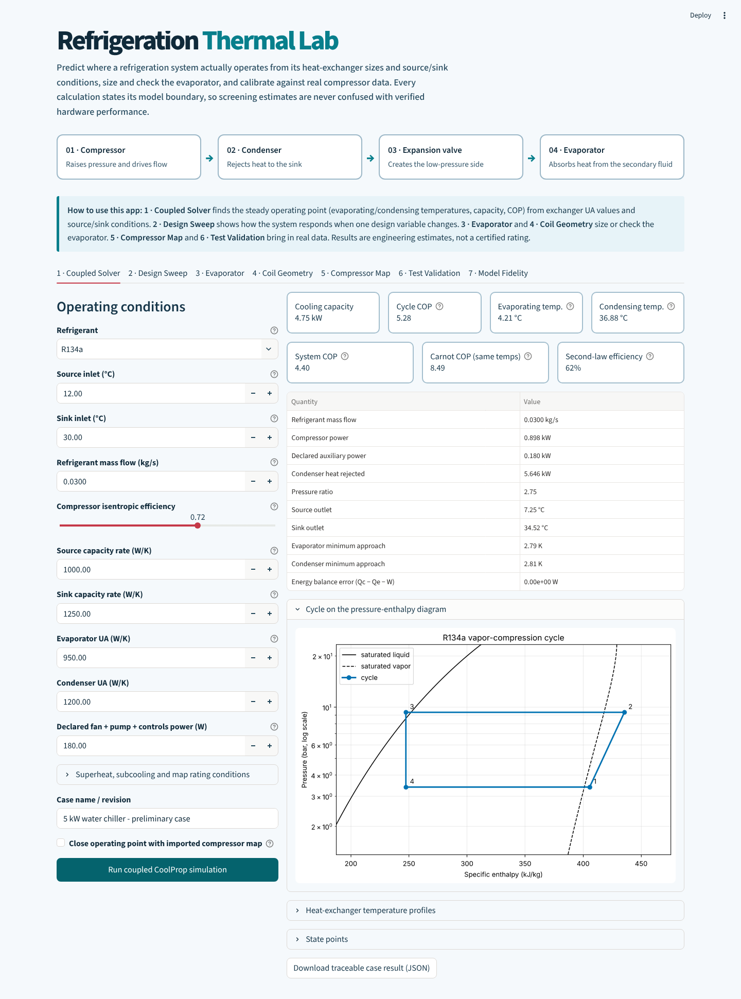
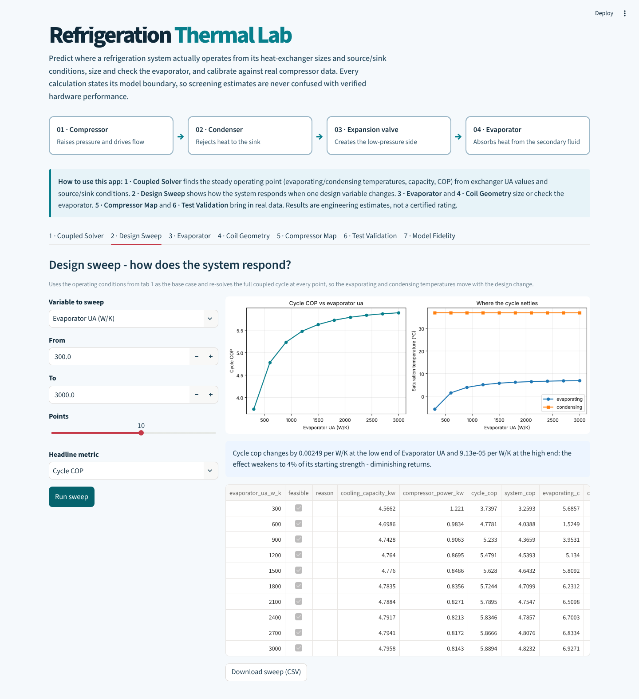
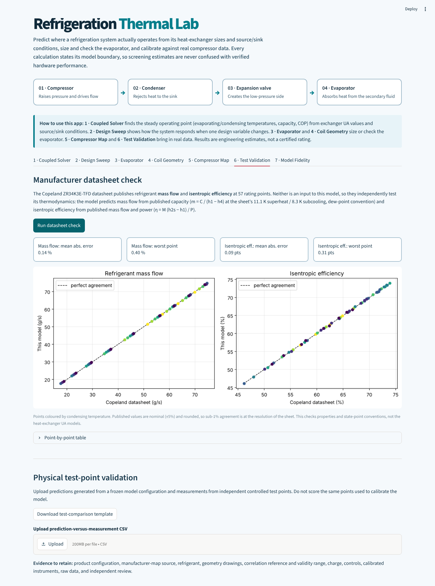

# Refrigeration Thermal Lab

[](https://github.com/Nishant2031/refrigeration-thermal-lab/actions/workflows/tests.yml)

**Live demo:** _add your Streamlit Community Cloud link here after deploying (see "Deploy" below)_

A steady-state vapor-compression refrigeration model in Python. It predicts **where a real system operates**: given heat-exchanger sizes (UA) and source/sink conditions, it solves for the evaporating and condensing temperatures, capacity, and COP. It also sizes evaporators and calibrates against manufacturer compressor data. All properties come from [CoolProp](http://www.coolprop.org/).



## Highlights

- **Coupled cycle solver.** A discretised (moving-boundary) evaporator and condenser handle superheat, two-phase, and subcooled zones. The solver finds the saturation temperatures at which the UA each exchanger *needs* equals the UA it *has*. A bracketed fallback handles hard cases, and physically impossible inputs get a specific explanation instead of a crash.
- **Checked against manufacturer data.** Against all 57 points of the Copeland ZR34K3E-TFD (R407C) datasheet, the model reproduces published refrigerant **mass flow within 0.14 %** (worst 0.40 %) and **isentropic efficiency within 0.09 points**. Neither quantity is a model input. [Details](docs/VALIDATION.md)
- **Compressor-map closure.** Imports a manufacturer map, fits it with a held-out validation split (0.7 % capacity error on unseen points), and corrects from the map's rating superheat/subcooling to the actual operating conditions. It never extrapolates outside the map's envelope.
- **Design sweeps.** Re-solve the whole system while varying one parameter, to see trade-offs such as the diminishing return from a larger evaporator.
- **Heat-exchanger tools.** Cooling load, ε-NTU screening, a tube-bundle thermal-resistance network, and a plate-evaporator secondary side (parallel-plate laminar Nu, Gnielinski turbulent).
- **Data checks.** Compressor maps that would beat the Carnot limit are rejected (this catches Btu/h data mislabelled as W, which happened in this project).
- **Tested.** 59 tests: analytical benchmarks, hand calculations, energy balances, edge cases, and a headless click-through of the whole app. CI runs them on every push.

| Design sweep | Datasheet check |
|---|---|
|  |  |

## Run it locally

```bash
python -m venv .venv
# Windows: .venv\Scripts\activate    macOS/Linux: source .venv/bin/activate
pip install -e ".[test]"
streamlit run app_streamlit.py
python -m pytest
```

## Use it from Python

```python
from thermal_model import CoupledInputs, solve_coupled_system

result = solve_coupled_system(CoupledInputs(
    fluid="R134a", source_inlet_c=12, sink_inlet_c=30,
    evaporator_ua_w_k=950, condenser_ua_w_k=1200, refrigerant_mass_flow_kg_s=0.03))
print(result.cycle.summary())   # 4.75 kW cooling, COP 5.28, Te 4.2 °C, Tc 36.9 °C
```

## How it works

| Module | Role |
|---|---|
| `cycle.py` | Four state points from CoolProp (dew-point saturation convention, AHRI 540) |
| `moving_boundary.py` | Segmented counterflow exchanger: required UA for a given duty, pinch detection |
| `solver.py` | Robust saturation-temperature closure; infeasibility diagnosis |
| `coupled.py`, `map_coupled.py` | Fixed-flow and compressor-map-driven operating points |
| `sweep.py` | One-parameter design sweeps |
| `evaporator.py`, `plate_evaporator.py`, `advanced.py` | Cooling load, ε-NTU, plate and tube-bundle UA, pressure drop |
| `data_workflow.py`, `datasheet_validation.py` | Map validation, fitting, held-out scoring, datasheet comparison |

Equations and assumptions: [docs/EQUATIONS.md](docs/EQUATIONS.md) · Evidence and limits: [docs/VALIDATION.md](docs/VALIDATION.md) · Learning path: [docs/TEACHING_GUIDE.md](docs/TEACHING_GUIDE.md) · Using real data: [docs/REAL_DATA_WORKFLOW.md](docs/REAL_DATA_WORKFLOW.md)

## Limitations

Steady state only. No refrigerant-side pressure drop. Boiling and condensing coefficients are user inputs. The plate model is a conservative smooth-channel estimate. Air cooling is dry only. The heat-exchanger and coupled predictions have **not** yet been validated against measured system data; the datasheet check covers the thermodynamics and compressor side. These are engineering estimates, not certified ratings.

## Deploy (free)

1. Push this folder to a public GitHub repository.
2. At [share.streamlit.io](https://share.streamlit.io), choose **Create app**, select the repo, and set the main file to `app_streamlit.py`.
3. Paste the resulting URL into "Live demo" at the top of this README.
